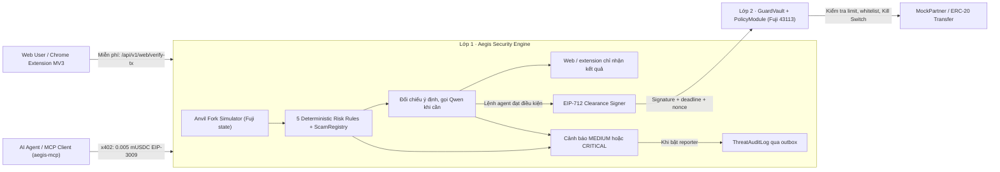
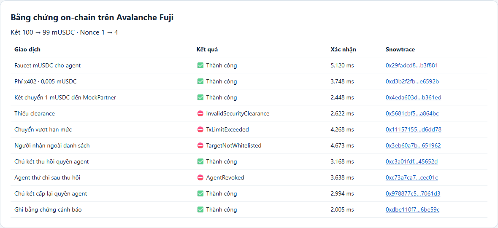

# AegisAVAX

[](https://github.com/tq11372/aegis-avax/actions/workflows/ci.yml)

[🎬 Video Demo (2:34)](https://drive.google.com/file/d/1lid3WKFfUcEIXGKZ0pjMfyysYwzzIgvp/view?usp=sharing) · [📑 Pitch Slides (22 trang)](https://docs.google.com/presentation/d/1GbwWTIyI_WBsYoN1tf5dfELDGwLOYKd3yoCp3-T3uqU/edit?usp=sharing) · [Bản PDF trong repo](docs/AegisAVAX-Pitch.pdf) · [🔗 GuardVault trên Snowtrace](https://testnet.snowtrace.io/address/0x4d0DA228a21F02c83ee3aF70E6702a489cD1019F) · [🔴 12 Biên nhận Live Proof Fuji](#live-proof-on-fuji) · [⛓️ Own L1 Aegis Audit (99321)](#aegis-audit-aegis-chain-id-99321) · [Hai biên nhận MCP trên Fuji](#mcp-fuji)

**Tường lửa giao dịch trước khi ký & Két bảo vệ AI Agent trên Avalanche** • Đội `AI_hihi11` (Trần Văn Quân) • Team1 Vietnam UniHack 2026.

AegisAVAX kiểm tra giao dịch trước khi ký và giới hạn quyền chi tiêu của AI agent bằng hai lớp độc lập theo triết lý **"Invisible Web3"**:
1. **Lớp 1 — Pre-Execution Firewall (Off-chain trên Anvil Fork):** Chạy thử calldata thô trên trạng thái thật của Avalanche Fuji (`eth_simulateV1`) để đọc **`State Diff`** và sự kiện giải mã (`Transfer`, `Approval`, `ApprovalForAll`), quét **5 luật rủi ro tất định** (`UNLIMITED_APPROVAL`, `DRAIN_PATTERN`, `ADDRESS_POISONING`, `UNVERIFIED_OR_SCAM_CONTRACT`, `ABNORMAL_SLIPPAGE_OR_DANGEROUS_CALL`), đối chiếu ý định bằng kiểm tra tất định rồi gọi Qwen khi cần. Web trả kết quả quét. Route agent chỉ cấp **EIP-712 Security Clearance** sau khi kiểm tra ý định, policy và mô phỏng lệnh chi.
2. **Lớp 2 — Cryptographic Guardrails (On-chain trên Avalanche Fuji):** Hợp đồng `GuardVault` + `PolicyModule` phi lưu ký cưỡng chế cứng `txLimit`, `dailyCap` (cửa sổ trượt 24 giờ dùng tìm kiếm nhị phân $O(\log n)$, giữ nguyên khi đổi session key), `tokenWhitelist`, `targetWhitelist`, xác thực chữ ký EIP-712 chống replay và nút **Kill Switch** (`revokeAgent()` / `pause()`).

Bảy hợp đồng cốt lõi đã triển khai và đối chiếu bytecode đang chạy (`exact_match`) trên **Avalanche Fuji C-Chain (`43113`)**. [Địa chỉ, giao dịch và bằng chứng xác minh](#verified-contract-addresses) · [Dàn ý Slide, Kịch bản Demo & Q&A](docs/PITCH_AND_DEMO.md)

### Tóm tắt đối chiếu theo 6 tiêu chí Ban Giám Khảo (100 điểm)

| Tiêu chí chấm điểm | Hạng mục đã hoàn thành & kiểm chứng | Bằng chứng trực tiếp |
| --- | --- | --- |
| **Technical Implementation (25đ)** | • **Luồng đầu-cuối hoàn chỉnh:** Anvil State-Diff Simulator + 5 luật rủi ro tất định + Bộ đối chiếu bất biến ý định (kiểm tra tất định, Qwen xử lý các lệnh còn lại) + Chế độ yêu cầu hai chữ ký EIP-712 (`ownerApproval` & `SecurityClearance`) + MCP Server (`aegis-mcp` có trần phí phiên) + Chrome Extension MV3 + SQLite Outbox (`signed_tx` crash-recovery).<br>• **Kiểm thử tự động & Định lượng:** `27/27` Foundry tests (một test fuzz chạy 256 lượt), `10/10` Node/MCP tests, 500 ca hồi quy do đội tự thiết kế, đối chứng 3 chế độ (*Ablation Study*) và đo tải đồng thời. | • [GitHub Actions CI](https://github.com/tq11372/aegis-avax/actions)<br>• [Phạm vi bộ thử](#chạy-giao-diện-và-bộ-đánh-giá)<br>• [`docs/operational-check.json`](docs/operational-check.json) |
| **Avalanche Integration (25đ)** | • **7 hợp đồng có runtime `exact_match`** trên Fuji C-Chain (`43113`, `evm_version = "cancun"`, OpenZeppelin `v5.6.1`).<br>• **12 biên nhận phiên đầu trên Fuji** và [2 biên nhận MCP mới](#mcp-fuji). Phiên đầu gồm `x402` EIP-3009 (`0,005 mUSDC`), `GuardVault.execute` (`1 mUSDC`), **4 biên nhận revert, tên lỗi đối chiếu bằng mô phỏng**, `Kill Switch` (`3.168 ms` + 2 lệnh UI EIP-1193), ghi `ThreatAuditLog`.<br>• **Own Avalanche L1 `Aegis Audit` (`99321`):** Đã `Committed` cả 3 giao dịch P-Chain (`CreateSubnetTx`, `CreateChainTx`, `ConvertSubnetToL1Tx`), **1 validator được P-Chain liệt kê**, 3 block EVM (`1–3`) qua RPC cục bộ. Đã thử chuyển dự phòng trên hai Anvil. | • [Bảng 12 biên nhận Fuji](#live-proof-on-fuji) (`npm run check:fuji`)<br>• [Bảng 7 hợp đồng Verified](#verified-contract-addresses)<br>• [`ConvertSubnetToL1Tx` trên P-Chain](https://build.avax.network/explorer/fuji/p-chain/tx/2FH3dGE7o2mz6VscxVvqUY5iwgeiNio7r1TG8ErHVYTGTBQbGR)<br>• [`docs/aegis-l1-proof.json`](docs/aegis-l1-proof.json) |
| **Creativity & Innovation (15đ)** | • Kết hợp **Pre-Execution State-Diff + Relational Intent Verification $\Phi(I, E)$** (chặn hóa đơn bị tiêm nhiễm sửa từ `3` thành `4 mUSDC` tới đúng đối tác whitelist) với **két on-chain `GuardVault`** và vi thanh toán máy-với-máy **`x402` (EIP-3009)** trên Avalanche. | • [`backend/src/intent.ts`](backend/src/intent.ts)<br>• [`backend/src/owner-intent.ts`](backend/src/owner-intent.ts)<br>• [`contracts/src/GuardVault.sol`](contracts/src/GuardVault.sol) |
| **Impact & Use Case (15đ)** | • Bản thử nghiệm xử lý hai tình huống: **ký mù (`Blind Signing`)** của người dùng ví (miễn phí trên web/Extension) và **AI Agent bị thao túng hóa đơn** (trả phí `0,005 mUSDC/lượt` qua MCP/`x402`). Nêu các câu hỏi pháp lý trước khi triển khai tại Việt Nam (Luật 71/2025/QH15, NQ 05/2025/NQ-CP, Luật 91/2025/QH15). | • [Phân tích pháp lý & Mô hình](#phap-ly)<br>• [Slide 02–04 & Slide 18–21](https://docs.google.com/presentation/d/1GbwWTIyI_WBsYoN1tf5dfELDGwLOYKd3yoCp3-T3uqU/edit?usp=sharing) |
| **Presentation & Pitching (10đ)** | Bộ 22 slide tiếng Việt trình bày luồng kiểm tra, ví dụ hóa đơn 3/4 mUSDC, kết quả thử nghiệm và nguồn pháp lý. Bản PDF có 19 vùng liên kết tới 17 URL khác nhau. | [Google Slides](https://docs.google.com/presentation/d/1GbwWTIyI_WBsYoN1tf5dfELDGwLOYKd3yoCp3-T3uqU/edit?usp=sharing) · [PDF](docs/AegisAVAX-Pitch.pdf) · [Kịch bản](docs/PITCH_AND_DEMO.md) |
| **UI/UX & Demo (10đ)** | • Giao diện tối giản 2 tab (Next.js, React) theo triết lý *"Invisible Web3"* (quét miễn phí không cần nối ví). Video demo **`02:34`** (giọng nam tiếng Việt + phụ đề) minh họa luồng thao tác trên bản demo cục bộ và hiển thị biên nhận lịch sử Fuji. | • [🎬 Video Demo công khai (2:34)](https://drive.google.com/file/d/1lid3WKFfUcEIXGKZ0pjMfyysYwzzIgvp/view?usp=sharing)<br>• [Ảnh Live Proof UI](docs/fuji-live-proof.png) |



## What it does

**Demo cục bộ.** Mở [AegisAVAX trên máy](http://127.0.0.1:3000). Tab Tx Firewall mô phỏng calldata miễn phí và hiển thị số dư trước/sau. Tab AI Agent Sandbox dùng ví thử trên Anvil, có thanh toán x402, hạn mức, danh sách người nhận và thu hồi session key. Biên nhận của phiên demo mở trên máy. Địa chỉ triển khai công khai ở bảng Fuji bên dưới.

## Live proof on Fuji

<a id="mcp-fuji"></a>

### Một lệnh MCP, hai giao dịch trên Fuji

Agent gọi tool `simulate_and_verify_tx` qua MCP. Backend trả HTTP 402. Agent ký phí 0,005 mUSDC, gửi lại yêu cầu kèm chữ ký thanh toán. Lệnh chuyển 1 mUSDC có chấp thuận riêng của chủ két. Backend dùng Qwen cục bộ để đối chiếu ý định, trả HTTP 200 cùng clearance và biên nhận trả phí. Sau đó agent gọi `GuardVault.execute`. Thứ tự HTTP và tên model được ghi ở máy chạy. Hai sự kiện chuyển tiền, người nhận, số tiền và nonce được kiểm riêng qua RPC Fuji.

| Bước | Block Fuji | Kết quả |
| --- | ---: | --- |
| [Thanh toán x402](https://testnet.snowtrace.io/tx/0x72a543a050cb86add1fa8aa85eed06f454988041365fb7e902923941f038e1f6) | 61430093 | Agent trả 5.000 đơn vị cơ sở mUSDC cho ví nhận phí của dự án. |
| [Két chuyển tiền](https://testnet.snowtrace.io/tx/0xfb1d3cce2eeb596282b7b5aee0d3a9b22578f3ac410dcc314716d0686965815b) | 61430094 | Két giảm từ 99 xuống 98 mUSDC, MockPartner tăng từ 1 lên 2 mUSDC, nonce tăng từ 6 lên 7. |

Sau `npm ci`, chạy **`npm run check:mcp-fuji`** để đọc lại hai biên nhận. Lệnh dùng RPC công khai, không cần ví hay model. Tổng gas hai giao dịch là 250.002.500.000 wei AVAX testnet (0,0000002500025 AVAX). [Log đã lược chữ ký](docs/fuji-mcp-proof.json) · [Script thực hiện lượt MCP](backend/scripts/proof-mcp-fuji.ts) · [Tra cứu ba biên nhận L1](docs/L1_RECEIPTS.md)

### Phiên kiểm tra hợp đồng trước đó

Tại block 61407365, két có 100 mUSDC và nonce 1. Tại block 61407405, két còn 99 mUSDC, MockPartner nhận 1 mUSDC và nonce đạt 4. Phí quét 0,005 mUSDC do agent trả riêng. Script chạy mô phỏng trên Anvil fork, kiểm tra ý định bằng Qwen và lấy clearance qua backend. Trên Fuji, script gửi trực tiếp giao dịch thanh toán EIP-3009 của x402. Ở phiên MCP mới phía trên, lượt 402 và lượt gửi lại đã được ghi trên cùng luồng thanh toán Fuji.

| Bước | Trạng thái | Lỗi khi mô phỏng | Block | Gas | Xác nhận (ms) | Biên nhận |
| --- | --- | --- | ---: | ---: | ---: | --- |
| Faucet mUSDC cho agent | success | — | 61407371 | 50609 | 5120 | [0x29fadcd8a8…](https://testnet.snowtrace.io/tx/0x29fadcd8a85bc2ce3e15bcb75bca015eab1533ef1e50fc063d4dc22955b3f881) |
| Phí x402 · 0,005 mUSDC | success | — | 61407377 | 82778 | 3748 | [0xd3b2f2fba8…](https://testnet.snowtrace.io/tx/0xd3b2f2fba87ae13388ab196e7cf9a83b1ae9085fce2acc9cf3ad9acf52e6592b) |
| Két chuyển 1 mUSDC đến MockPartner | success | — | 61407383 | 162308 | 2448 | [0x4eda603dac…](https://testnet.snowtrace.io/tx/0x4eda603dacb0636bd1845fc9f3357cd1442430c9210b6f4dc8cac65018b361ed) |
| Thiếu clearance | reverted | InvalidSecurityClearance | 61407384 | 150000 | 2622 | [0x5681cbf564…](https://testnet.snowtrace.io/tx/0x5681cbf564b3a13547217410ed7546249ab8549a4465534d51b3bd3476a864bc) |
| Chuyển vượt hạn mức | reverted | TxLimitExceeded | 61407385 | 150000 | 4268 | [0x1115715502…](https://testnet.snowtrace.io/tx/0x11157155029a2596a5e7d1b3c7a38732d7ccd33122e25ef978202e8152d6dd78) |
| Người nhận ngoài danh sách | reverted | TargetNotWhitelisted | 61407387 | 150000 | 4673 | [0x3eb60a7b22…](https://testnet.snowtrace.io/tx/0x3eb60a7b223b3ff2548c389deb13b2f55515d19e095755bc61c1f30640651962) |
| Chủ két thu hồi quyền agent | success | — | 61407392 | 34821 | 3168 | [0xc3a01fdfae…](https://testnet.snowtrace.io/tx/0xc3a01fdfae413b82ac008e7f2164fa15ed3ef47f17cc21a44d3936cd9545652d) |
| Agent thử chi sau thu hồi | reverted | AgentRevoked | 61407396 | 150000 | 3638 | [0xc73a7ca7d5…](https://testnet.snowtrace.io/tx/0xc73a7ca7d57e994fad2f624f4381c514812d4bc9be27edee77a3dc6571cec01c) |
| Chủ két cấp lại quyền agent | success | — | 61407401 | 52783 | 2994 | [0x978877c5a7…](https://testnet.snowtrace.io/tx/0x978877c5a7239fd52ceb1a0adc8d210569e6ac0722841c20a4b860cb2a7061d3) |
| Ghi bằng chứng cảnh báo | success | — | 61407405 | 49529 | 2005 | [0xdbe110f7f8…](https://testnet.snowtrace.io/tx/0xdbe110f7f8080a53b1ab157633eebf01a26f70c36d84cf39d7fd5df1896be59c) |

Bốn biên nhận `reverted` là kết quả mong đợi. Tên lỗi lấy từ mô phỏng và được đối chiếu bằng cách đọc lại block trước giao dịch. Cột thời gian ghi khoảng chờ ở máy chạy script đến khi nhận biên nhận, gồm cả việc lưu thông tin gửi và truy vấn RPC. Chạy `npm run check:fuji` để đối chiếu cả 12 biên nhận bằng RPC chỉ đọc. Nếu explorer từ chối truy cập, có thể dùng cùng lệnh này. [JSON](docs/fuji-live-proof.json) · [Ảnh giao diện](docs/fuji-live-proof.png)

Hai giao dịch bổ sung do giao diện gửi bằng keystore của owner qua ví thử nghiệm EIP-1193 trong Chromium. Giao diện đo từ lúc ví trả hash đến lúc nhận biên nhận. Agent đã được cấp lại quyền. [Thu hồi · 3038 ms](https://testnet.snowtrace.io/tx/0x58bbe66be17945a793806bad15a85f6fa2be039f054e14c91e6340bca27ec066) · [Cấp lại · 2294 ms](https://testnet.snowtrace.io/tx/0x8d0f2242af805b2ad385c78f0927c57db9d26ef4ac7c889d09784536681dc6f1)



## Quickstart (giám khảo)

| Cách kiểm tra | Thao tác từ thư mục gốc |
| --- | --- |
| A · Hợp đồng | Với Foundry và Node đã cài, chạy `cd contracts`, `npm ci`, rồi `forge test -vv`. |
| B · Backend và MCP | Với Node 22.18 trở lên, chạy `npm ci`, `npm run typecheck`, rồi `npm test`. |
| C · Demo đầy đủ | Sau A và B, tạo `.env` từ `.env.example`. Đặt Anvil trên PATH hoặc khai báo `ANVIL_BIN`. Điền `LLM_BASE_URL`, `LLM_MODEL`, `LLM_API_KEY` theo endpoint Chat Completions tương thích OpenAI có hỗ trợ JSON. Có thể dùng Qwen cục bộ hoặc endpoint sẵn có. Chạy `npm run dev:demo` và `npm run dev:web` ở hai terminal. Mở [giao diện](http://127.0.0.1:3000), rồi chạy `npm run eval` ở terminal khác. |

### Chạy giao diện và bộ đánh giá

Từ gốc repo, chạy `npm ci`, cài phụ thuộc & build hợp đồng (`cd contracts && npm ci && forge build`), và tạo file môi trường nếu chưa có (`Copy-Item .env.example .env`). Cấu hình model theo mục “Chạy với mô hình thật trên máy”. Trong ba terminal ở gốc repo, chạy từng lệnh sau theo thứ tự.

1. `npm run model:local` khởi động Qwen ở cổng 8091.
2. `npm run dev:demo` tạo fork từ block Fuji hiện hành, nạp 50 mUSDC vào két thử và mở dịch vụ ở cổng 4021/4022. Khởi động lại sẽ tạo một phiên mới.
3. `npm run dev:web` mở giao diện ở cổng 3000. Để dùng bản production, chạy `npm run build -w frontend` và `npm run start -w frontend`.

Chạy `npm run eval` khi két demo rảnh để kiểm tra hồi quy 500 kịch bản do đội tự thiết kế. Đội cũng viết nhãn kỳ vọng. Hệ thống coi MEDIUM là cảnh báo. Bốn kết quả trái nhãn gồm hai lệnh nêu nhiều giá và hai lệnh gửi AVAX đến MockPartner, hợp đồng không nhận AVAX. Hai nhóm cần được hiểu riêng: lệnh mơ hồ về ý định và lệnh thực thi bị revert. Chưa có đánh giá mù độc lập về ý định người dùng. Các tỷ lệ của bộ mẫu nội bộ đã được rút khỏi hồ sơ chấm. [Mã tạo kịch bản](evals/run_eval.ts)

**Phạm vi sử dụng & Cơ sở học thuật.** Extension hiện khiên trên trang demo; ở trang khác người dùng có thể dùng popup. Ví EOA tự quyết định ký; bộ quét yêu cầu xác nhận độc lập cho đích lạ. `GuardVault` thực thi chuyển token thanh toán đến đích được phép. Các công trình sau là tài liệu thiết kế. Đội dùng bộ thử tự xây dựng và chưa tái lập kết quả của các tác giả.
- **CaMeL** (*Defeating Prompt Injections by Design*, Debenedetti et al., Google DeepMind & ETH Zurich 2025, [arXiv:2503.18813](https://arxiv.org/abs/2503.18813)) — tách luồng điều khiển khỏi dữ liệu không tin cậy và kiểm tra bất biến quan hệ $\Phi(I, E)$.
- **Spotlighting** (Hines et al., Microsoft Research 2024, [arXiv:2403.14720](https://arxiv.org/abs/2403.14720)) & **StruQ** (Chen et al., UC Berkeley, [USENIX Security 2025](https://www.usenix.org/conference/usenixsecurity25/presentation/chen-sizhe) / [arXiv:2402.06363](https://arxiv.org/abs/2402.06363)) — đóng gói dữ liệu trong thẻ `<untrusted_user_intent>` kèm Grammar-Constrained JSON Schema.
- **AgentDojo** ([arXiv:2406.13352](https://arxiv.org/abs/2406.13352)), **InjecAgent** ([arXiv:2403.02691](https://arxiv.org/abs/2403.02691)), **BIPIA** ([arXiv:2312.14197](https://arxiv.org/abs/2312.14197)) & **ERC-7579** ([EIP-7579](https://eips.ethereum.org/EIPS/eip-7579)). Đội chưa đo riêng tác động của Qwen trên tập mù bên ngoài.

**Đo tải trên máy demo.** Tại fork 61420566, mỗi cấu hình chạy ba đợt, dùng chuyển mUSDC đến MockPartner. Một yêu cầu mỗi đợt thành công 3/3. Bốn yêu cầu khác nhau đồng thời thành công 9/12, ba yêu cầu nhận HTTP 429 (`Retry-After: 1`); p95 của chín lượt thành công là 5.199 ms. Bốn yêu cầu giống nhau đồng thời thành công 12/12 (nhờ gộp yêu cầu trùng `webScans`), p95 là 1.878 ms. Thời gian gồm cả lượt đầu. Đây là số đo ngắn trên máy đội. [Từng yêu cầu và mã HTTP](docs/operational-check.json)

**Đối chứng ba chế độ (*Ablation Study* tại block `61420617`).** Trên cùng mô phỏng với 4 lệnh nêu đúng số tiền (`1..4 mUSDC`) và 4 lệnh lệch `+1 mUSDC`, phép đo tách bạch vai trò của từng thành phần ([Mã và điều kiện đo](evals/operational-check.ts)):

| Chế độ cấu hình | 4 lệnh sạch khớp số tiền | 4 lệnh hóa đơn lệch `+1 mUSDC` | Nhận xét kỹ thuật |
| --- | --- | --- | --- |
| **1. Chỉ dùng 5 luật State-Diff (`Rules-Only`)** | Cho qua 4/4 | **Bỏ lọt 4/4** | Đích nhận (`MockPartner`) nằm trong whitelist và số tiền `< 80%` số dư nên 5 luật ngưỡng không chặn được lệch ý định. |
| **2. Luật + Bộ đối chiếu tất định (`Qwen` tắt)** | Trả `MEDIUM` 4/4 (fail-closed) | **Chặn cứng 4/4 (`CRITICAL`)** | Bộ đối chiếu số tiền tất định (`verifier: intent`) phát hiện 4/4 lệnh lệch số tiền trong phép thử. Route web chỉ trả kết quả quét. |
| **3. Đầy đủ (`Rules` + `Intent` + `Qwen2.5-1.5B`)** | **Duyệt `SAFE` 4/4 (`verifier: model`)** | **Chặn cứng 4/4 (`CRITICAL`)** | Kết hợp cả độ an toàn tất định trước hóa đơn sửa số tiền lẫn khả năng duyệt câu lệnh tự nhiên hợp lệ. |

**Phí một lần thanh toán.** Biên nhận x402 Fuji ở block 61407377 dùng 82.778 gas với giá thực tế 160 wei/gas, tức relayer trả 13.244.480 wei AVAX testnet. Agent trả riêng 0,005 mUSDC. Chưa đo điện năng, khấu hao máy, nhân sự và vận hành validator để tính giá vốn đầy đủ. [Biên nhận thanh toán](https://testnet.snowtrace.io/tx/0xd3b2f2fba87ae13388ab196e7cf9a83b1ae9085fce2acc9cf3ad9acf52e6592b)

**Nguồn lệnh thanh toán.** Với `AEGIS_REQUIRE_OWNER_INTENT=true`, route trả phí yêu cầu thêm `ownerApproval: {validUntil, signature}`. Chủ két ký EIP-712 trên lệnh đã xác nhận độc lập gồm agent, token, đích, số tiền theo đơn vị cơ sở, nonce két và hạn chót. Dùng [ownerPayment](backend/src/owner-intent.ts) để tạo typed data. Demo cấp chữ ký owner thử trên Anvil cho đúng 3 mUSDC đến MockPartner. Hóa đơn đề xuất 4 mUSDC bị bộ đối chiếu từ chối. Khi nonce thay đổi, phải đọc lại nonce và lấy chấp thuận mới. Trước khi thực thi, demo đọc lại nonce và hạn chót. Khi cần xin clearance mới, kiểm biên nhận x402 đã có trước khi trả thêm phí. Nếu khóa signer của két bị lộ, chủ két tạm dừng, rút tài sản và chuyển sang két mới với signer mới vì địa chỉ signer được cố định khi triển khai. Chế độ agent được ủy quyền (biến đặt false) dựa vào policy két và dữ liệu của bên gọi.

**Vận hành.** Audit outbox lưu bằng SQLite tại AUDIT_OUTBOX_PATH. Mỗi mục giữ ID, chain đã chọn và receipt khi xác nhận. Sau một lượt phát có kết quả chưa rõ, worker đối chiếu đúng chain trước khi kết luận. Kiểm tra các hàng receipt IS NULL, kiểm RPC và giao dịch của reporter trước khi vận hành lại một mục kẹt. Lưu thư mục này trên ổ bền vững, giới hạn quyền đọc cho tài khoản vận hành vì có giao dịch đã ký chờ phát. Thời gian failover đã đo trên hai Anvil cục bộ. Demo Anvil tắt reporter để các lần quét trong demo không ghi lên mạng công khai. RPC của chain 99321 chỉ mở trên máy vận hành. Phí demo là 0,005 mUSDC testnet; giá thương mại, chi phí mỗi lượt và nhu cầu thị trường còn phải đo.


Bước 1 triển khai két `GuardVault` và bộ quy tắc `PolicyModule`. Chủ két nạp token bằng ERC-20 transfer, cấp session key và chọn người nhận. Agent chỉ được chuyển token thanh toán đã duyệt. Két đọc địa chỉ người nhận và số tiền trực tiếp từ calldata, kiểm tra hạn mức rồi xác thực chữ ký EIP-712 trước khi chuyển. Hạn mức ngày tính trên 24 giờ gần nhất và tiếp tục áp dụng khi đổi session key.

| Thành phần | Vai trò trong bản thử nghiệm |
| --- | --- |
| GuardVault, PolicyModule | Hạn mức mặc định 10 mUSDC/lệnh và 25 mUSDC/24 giờ. Chỉ chủ két được rút AVAX hoặc token. Chủ két có thể thu hồi agent hoặc tạm dừng két. |
| MockUSDC | Token 6 chữ số thập phân, faucet 100 mUSDC/lần. Hỗ trợ chuyển, nhận và hủy ủy quyền EIP-3009. |
| MockPartner, MockDrainer | Hai địa chỉ mẫu để phân biệt người nhận được phép và địa chỉ bị gắn cờ. MockDrainer chỉ đóng vai địa chỉ thử nghiệm. |
| ScamRegistry, ThreatAuditLog | Chủ registry quản lý cờ rủi ro. Reporter được cấp quyền ghi sự kiện ThreatLogged gồm ID bằng chứng, riskHash, mức rủi ro và thời điểm quan sát. Mỗi ID chỉ được ghi một lần. Hash giao dịch nằm trong biên nhận. |

**1. Vì sao phải kiểm tra on-chain? (*Why on-chain?*)** Dặn AI qua System Prompt hoặc lớp lọc off-chain có thể bị vượt qua bởi Prompt Injection hoặc rò rỉ khóa gọi API. Chỉ **Smart Contract on-chain** (`GuardVault` + `PolicyModule`) mới cưỡng chế cứng bằng mật mã ngay lúc thực thi EVM: dù agent có session key hợp lệ và cố gọi thẳng hợp đồng bỏ qua Lớp 1, giao dịch vẫn `REVERT` với mã lỗi tường minh (`InvalidSecurityClearance`, `TargetNotWhitelisted`, `TxLimitExceeded`, `DailyCapExceeded`, `AgentRevoked`). Thu hồi quyền (`revokeAgent()` / `pause()`) tăng `nonce` ngay khi giao dịch được mạng xác nhận, vô hiệu mọi chữ ký cũ.

**2. Vì sao chọn Avalanche? (*Why Avalanche?*)**
- **Độ trễ xác nhận thấp cho nút khẩn cấp Kill Switch:** Trên Fuji C-Chain (`43113`), máy chạy thử nhận biên nhận `revokeAgent()` sau **`3.168 ms`** (qua script) và **`3.038 ms`** (qua UI EIP-1193); giao dịch kế tiếp của agent bị hợp đồng từ chối ngay với mã lỗi `AgentRevoked`.
- **Phí gas thấp cho vi thanh toán Agent `x402` (EIP-3009):** Cả 13 giao dịch triển khai và cấu hình 7 hợp đồng trên Fuji tốn `0,00000000070361181 AVAX testnet`; một giao dịch settle phí `x402` (`0,005 mUSDC`) ở block `61407377` chỉ dùng `82.778 gas` (`13.244.480 wei AVAX`), phù hợp cho thanh toán máy-với-máy (M2M) theo từng lượt gọi API/MCP.
- **Kiến trúc đa chuỗi với Own Avalanche L1 (`Aegis Audit`, Chain ID `99321`):** Tách riêng hợp đồng `ThreatAuditLog` sang L1 chuyên biệt (đã hoàn tất `ConvertSubnetToL1Tx` và chạy validator tự vận hành trên Fuji P-Chain) để ghi nhật ký cảnh báo mà không tranh chấp blockspace với két thanh toán trên C-Chain, kèm SQLite outbox và tùy chọn dự phòng trên Fuji khi lỗi xảy ra trước khi phát. [Biên nhận và số liệu](#live-proof-on-fuji)

<a id="phap-ly"></a>

**3. Mô hình doanh thu & Ranh giới pháp lý tại Việt Nam (*Where does the money come from & Legal limits in VN?*)**
- **Dòng tiền (*Where does the money come from?*):** Người dùng cá nhân sử dụng Web UI (`Tx Firewall`) và Chrome Extension **miễn phí**. Các AI Agent / dApp bên thứ 3 trả phí vi mô **`0,005 mUSDC / lượt`** (`5.000` đơn vị) qua giao thức **`x402` v2 (EIP-3009)** trên route `/api/v1/agent/verify-tx` và MCP server `aegis-mcp` (mặc định giới hạn trần `0,1 mUSDC / phiên MCP`) mà không cần tạo tài khoản hay thẻ tín dụng.
- **Phạm vi pháp lý tại Việt Nam.** Phí demo được trả bằng token thử trên testnet. Chỉ chủ két có quyền rút. Đội chưa đánh giá điều kiện cấp phép cho dịch vụ thương mại. Địa chỉ ví và mã băm có thể liên kết với cá nhân. Trước khi thử với khách hàng cần xác định mục đích xử lý, dữ liệu cần thu và thời gian lưu. [Luật Công nghiệp công nghệ số, Điều 46–47 (văn bản hợp nhất)](https://vanban.chinhphu.vn/?docid=217003&pageid=27160) · [Nghị quyết 05/2025/NQ-CP](https://vanban.chinhphu.vn/?classid=509&docid=215249&pageid=27160) · [Luật Bảo vệ dữ liệu cá nhân 91/2025/QH15](https://vanban.chinhphu.vn/?docid=214590&pageid=27160&typegroupid=3)

## How to run

### Tiện ích Chrome và nhật ký Vòng 2

Trong `chrome://extensions`, bật Developer mode, chọn Load unpacked và chọn thư mục `extension/` của repo. Bấm mô phỏng trong tab Tx Firewall để xem kết quả ở góc trang. Popup cũng nhận JSON gồm `from`, `to`, `data`, `value`, `userIntent`. Khi mở popup, tiện ích so tên miền của tab với bản danh sách MetaMask tải về máy. Nguồn dữ liệu được cập nhật sau 24 giờ khi dùng. Ví và khóa ký nằm ngoài tiện ích. [Nguồn dữ liệu tên miền](https://github.com/MetaMask/eth-phishing-detect)

Để kiểm thử extension trong một hồ sơ Chromium tạm, chạy ba dịch vụ demo bên trên, `npx playwright install chromium`, rồi `npm run test:extension`. Chạy `npm run test:audit` để tự tạo hai Anvil, ghi và đọc sự kiện `ThreatLogged` trên cả hai mạng, kiểm tra ID trùng và thời gian chuyển dự phòng.

Để tái lập trên **một L1 riêng**, tạo chain EVM trong Builder Console, khởi chạy validator, lưu URL RPC và lấy chain ID từ chính RPC. Phân bổ gas native cho deployer và reporter. Đặt `AUDIT_L1_RPC_URL`, `AUDIT_L1_CHAIN_ID`, `DEPLOYER_ADDRESS`, `AUDIT_REPORTER_ADDRESS` trong môi trường terminal. Trong `contracts/`, chạy lệnh sau để mô phỏng. Sau khi xác nhận chain ID, chạy lại với `--broadcast --account <tên-keystore>` để ký và lưu địa chỉ từ biên nhận triển khai. [Avalanche Builder Console](https://build.avax.network/console/create-l1)

```powershell
forge script script/DeployAudit.s.sol:DeployAudit --rpc-url $env:AUDIT_L1_RPC_URL --sender $env:DEPLOYER_ADDRESS
```

Sau khi điền địa chỉ mới vào cấu hình, chạy `npm run verify:audit` ở gốc repo. Lệnh chỉ đọc chain ID, block, bytecode thực tế, owner và quyền reporter. Lưu JSON kết quả cùng biên nhận triển khai và cấp quyền trong bàn giao. Việc tạo L1 và validator được đối chiếu riêng trên Builder Hub.

Đặt địa chỉ mới vào `AUDIT_LOG_CONTRACT_ADDRESS`. Backend dùng `AUDIT_REPORTER_PRIVATE_KEY` của ví đã được cấp quyền và nạp gas để ghi hash cho các kết quả MEDIUM và CRITICAL. Muốn dùng dự phòng, đặt `AUDIT_FALLBACK_RPC_URL` trỏ tới Fuji và `AUDIT_FALLBACK_CONTRACT_ADDRESS` trỏ tới ThreatAuditLog đã xác minh bên dưới. Cùng một reporter cần có quyền và gas trên cả hai mạng. Worker kiểm tra chain ID, quyền và mô phỏng trước khi phát giao dịch. Khi lỗi xảy ra trước khi phát, worker có thể đổi mạng. Nếu chưa rõ kết quả sau khi phát, kiểm tra biên nhận trên mạng vừa dùng. Backend xử lý nhật ký riêng để giao diện vẫn trả kết quả mô phỏng. SQLite lưu giao dịch đã ký trước khi phát. Khi kết nối phục hồi, worker đọc trạng thái hoặc gửi lại đúng chuỗi byte đã ký trên cùng mạng, giữ nguyên nonce và hash. Bản ghi cũ đã chọn mạng nhưng thiếu giao dịch đã ký cần đối soát thủ công. Worker xử lý theo thứ tự, nên một mục chưa xác định có thể làm các mục sau chờ.

### Backend và MCP

Từ thư mục gốc, dùng Node.js 22.18 trở lên và Anvil trên PATH (hoặc đặt đường dẫn trong `ANVIL_BIN`). Trên PowerShell:

```powershell
npm ci
npm run typecheck
npm test
if (!(Test-Path .env)) { Copy-Item .env.example .env }
npm run dev:backend
```

Backend phục vụ tại `http://127.0.0.1:4021`. Cổng web nhận `POST /api/v1/web/verify-tx` với `from`, `to`, `data`, `value` (chuỗi số nguyên đơn vị wei) và `userIntent`. Có thể bổ sung `knownRecipients` để so sánh lịch sử và `minOutput: {token, amount}` để kiểm tra lượng token đầu ra tối thiểu. Phản hồi có block/hash nguồn, số dư AVAX và token trước/sau, event, trạng thái revert, mã luật kích hoạt và giải thích tiếng Việt.

Ví dụ PowerShell sau mô phỏng trên trạng thái Fuji hiện tại:

```powershell
$to = '0x1C552a98A274FFc69230816b2Bf892543E1c9ee8'
$body = @{
  from = '0x4d0DA228a21F02c83ee3aF70E6702a489cD1019F'
  to = '0x7620FaBA82e05bBb889f80F3E20429A81f2e7113'
  data = (cast calldata 'transfer(address,uint256)' $to 3000000).Trim()
  value = '0'
  userIntent = 'Chuyển 3 mUSDC đến MockPartner'
} | ConvertTo-Json
Invoke-RestMethod http://127.0.0.1:4021/api/v1/web/verify-tx -Method Post -ContentType 'application/json; charset=utf-8' -Body $body
```

Backend đọc `LLM_BASE_URL`, `LLM_MODEL` và `LLM_API_KEY` cho API tương thích Chat Completions, có hỗ trợ JSON. Nếu thiếu model hoặc phản hồi sai định dạng, web trả `MEDIUM`, `verifier: unavailable`, `clearance: null`. Luật rủi ro có thể trả `CRITICAL` mà không cần gửi dữ liệu tới model. Các block mô phỏng và sự kiện trả về chỉ tồn tại trên fork.

Agent gọi `POST /api/v1/agent/verify-tx`. Backend trả `402` cùng `PAYMENT-REQUIRED` ghi Fuji `eip155:43113`, token mUSDC và giá `5000`. Khách ký EIP-3009 rồi gửi lại trong `PAYMENT-SIGNATURE`. Khi thành công, `PAYMENT-RESPONSE` chứa hash giao dịch thanh toán. Cấu hình `X402_FACILITATOR_URL` cho facilitator hỗ trợ token của dự án, hoặc `RELAYER_PRIVATE_KEY` của ví chuyên trả gas để dùng facilitator trong tiến trình. Backend đối chiếu ý định, kiểm tra policy, chữ ký và mô phỏng `GuardVault.execute` trước khi trả clearance. Với lệnh có thể ký, dùng mẫu `Chuyển <số> mUSDC đến <địa chỉ hoặc MockPartner>`. Route web luôn trả `clearance: null`. [Starter x402 của BTC](https://team1vn.xyz/demos.html#x402-pay-per-request)

Chạy `npm run dev:mcp` để mở server MCP qua stdio. MCP client cũng có thể khởi chạy `node mcp-server/src/server.ts` từ repo, truyền `AEGIS_API_URL`, `X402_PAY_TO` và `X402_PAYER_PRIVATE_KEY` trong môi trường của tiến trình. Tool `simulate_and_verify_tx` chỉ chấp nhận đúng chain, token, người nhận phí và số tiền ở trên. Mặc định một tiến trình MCP dành tối đa 100.000 đơn vị cơ sở (0,1 mUSDC) cho tối đa 20 lượt ký phí. Đặt `X402_SESSION_BUDGET_ATOMIC` để đổi trần. Mỗi lượt dành trước 5.000 đơn vị, kể cả khi chưa biết kết quả thu phí. Khởi động tiến trình mới sẽ mở ngân sách phiên mới. Ví thanh toán cần mUSDC. Backend dùng khóa signer tương ứng `GuardVault.signer()` để ký clearance.

Chạy `npm run test:fork` sau khi đã `npm ci` và `forge build` trong `contracts/`. Phép thử dùng RPC Fuji để đọc dữ liệu và explorer để tra mã nguồn. Nó tạo ví tạm, thanh toán 0,005 mUSDC và thực thi clearance trên Anvil cục bộ, rồi kiểm tra lệnh đáng ngờ và lệnh thiếu chữ ký. Dịch vụ model trong phép thử là fixture HTTP. Hash của phép thử thuộc chain cục bộ.

#### Chạy với mô hình thật trên máy

Máy của dự án dùng llama.cpp CPU build `b12572` và Qwen2.5-1.5B-Instruct Q4_K_M. Tệp GGUF có SHA-256 `6a1a2eb6d15622bf3c96857206351ba97e1af16c30d7a74ee38970e434e9407e`. Trên máy khác, tải runtime phù hợp và tệp GGUF cùng phiên bản. [llama.cpp b12572](https://github.com/ggml-org/llama.cpp/releases/tag/b12572) · [Qwen GGUF chính thức](https://huggingface.co/Qwen/Qwen2.5-1.5B-Instruct-GGUF)

Trong `.env`, đặt `LLAMA_SERVER_BIN` và `LLM_GGUF_PATH` thành đường dẫn cục bộ, `LLM_BASE_URL=http://127.0.0.1:8091/v1` và `LLM_MODEL=qwen2.5-1.5b-instruct`. Chạy `npm run model:local` trong một terminal, rồi `npm run test:fork:llm` ở terminal khác. Phép thử dùng model thực; x402 và thực thi lệnh chỉ ghi lên Anvil. Yêu cầu có số tiền hoặc địa chỉ rõ ràng được đối chiếu độc lập với kết quả model.

### Hợp đồng Foundry


Cần Node.js/npm và Foundry (`forge`, `cast`). Tại thư mục gốc của repo, chạy:

```sh
cd contracts
npm ci
forge test -vv
```

Foundry dùng Solidity 0.8.30, EVM Cancun và OpenZeppelin Contracts 5.6.1. Lần biên dịch đầu tiên cần tải solc. Có thể dùng `forge test -vv --use <đường-dẫn-solc-0.8.30>` với compiler cài sẵn.

| Bộ kiểm thử | Kết quả trên máy |
| --- | --- |
| GuardVault | 20/20, gồm 256 lần fuzz cho số tiền giao dịch |
| MockUSDC | 5/5 |
| ScamRegistry và ThreatAuditLog | 2/2 |
| Diễn tập DeployFuji trên Anvil | 7 hợp đồng có bytecode, 13/13 giao dịch có biên nhận thành công |

### Tích hợp chữ ký

Két dùng domain EIP-712 có `name = AegisAVAX GuardVault`, `version = 1`, chain ID của mạng và `verifyingContract` là địa chỉ két. Backend đọc `agent()` và `nonce()` ngay trước khi ký. Trong struct bên dưới, `target` là địa chỉ hợp đồng mUSDC. Người nhận được mã hóa trong calldata của `transfer(recipient, amount)`. `value` bằng 0, `deadline` tính bằng giây Unix.

```text
SecurityClearance(address vault,address agent,address target,bytes32 calldataHash,uint256 value,uint256 nonce,uint256 deadline)
```

Sau khi nhận chữ ký, session key gọi `execute(target, data, 0, deadline, signature)`. Hợp đồng tự tính `keccak256(data)` và tiêu thụ nonce khi giao dịch thành công. Backend có thể đối chiếu digest bằng `clearanceDigest(...)`. MockUSDC có domain riêng với tên `Aegis Mock USDC`, phiên bản `1` và địa chỉ token.

### Triển khai trên Fuji

Chuẩn bị ba địa chỉ riêng cho chủ két, backend ký clearance và agent. Chủ két cần AVAX testnet để trả gas. Từ thư mục `contracts`, nhập khóa của ví triển khai vào keystore mã hóa qua prompt của Foundry:

```powershell
cast wallet import aegis-fuji --interactive
$env:DEPLOYER_ADDRESS = (cast wallet address --account aegis-fuji).Trim()
$env:AEGIS_SIGNER_ADDRESS = Read-Host 'Địa chỉ công khai của backend signer'
$env:AGENT_ADDRESS = Read-Host 'Địa chỉ công khai của agent'
$env:FUJI_RPC_URL = 'https://api.avax-test.network/ext/bc/C/rpc'
cast chain-id --rpc-url $env:FUJI_RPC_URL
```

Kiểm tra kết quả là `43113`. Chạy mô phỏng để xem ước tính gas, sau đó gửi giao dịch và yêu cầu xác minh mã nguồn:

```powershell
forge script script/DeployFuji.s.sol:DeployFuji --rpc-url $env:FUJI_RPC_URL --sender $env:DEPLOYER_ADDRESS
forge script script/DeployFuji.s.sol:DeployFuji --rpc-url $env:FUJI_RPC_URL --sender $env:DEPLOYER_ADDRESS --account aegis-fuji --broadcast --verify --verifier custom --verifier-url https://build.avax.network/api/verify/43113/api
```

Script tạo bảy hợp đồng, cấu hình whitelist, đánh dấu địa chỉ mẫu, cấp quyền reporter và agent, rồi nạp 100 mUSDC vào két. Sau khi gửi thật lên Fuji, dùng manifest của **chính lần chạy đó** để lấy địa chỉ:

```powershell
$run = Get-Content -Raw broadcast/DeployFuji.s.sol/43113/run-latest.json | ConvertFrom-Json
$run.transactions | Where-Object transactionType -eq 'CREATE' | Select-Object contractName,contractAddress,hash
```

Nếu các giao dịch đã xác nhận nhưng bước xác minh bị gián đoạn, chạy `forge build --build-info` với cùng cấu hình. Trên trang địa chỉ từng hợp đồng, chọn **Contract → Verify contract**, tải build-info trong `out/build-info/` và chọn đúng tên contract. [Hướng dẫn xác minh của Avalanche](https://build.avax.network/docs/tooling/contract-verification)

## Verified Contract Addresses

Ngày 20/11/2026, Fuji (chain ID `43113`) xác nhận 13 giao dịch từ block `61380106` đến `61380179`. Cả bảy có runtime bytecode `exact_match`. GuardVault và MockUSDC còn có creation bytecode `exact_match`. Năm kết quả còn lại không trả kết quả khớp creation bytecode. Tổng phí của cả lượt triển khai và cấu hình là **0,00000000070361181 AVAX testnet**.

| Hợp đồng | Địa chỉ trên Fuji | Xác minh | Biên nhận |
| --- | --- | --- | --- |
| GuardVault | [`0x4d0DA228a21F02c83ee3aF70E6702a489cD1019F`](https://testnet.snowtrace.io/address/0x4d0DA228a21F02c83ee3aF70E6702a489cD1019F) | [Sourcify](https://repo.sourcify.dev/43113/0x4d0DA228a21F02c83ee3aF70E6702a489cD1019F) | [Giao dịch tạo](https://testnet.snowtrace.io/tx/0xade098b6607a5176434abd93a837568d7928f4b21dffef8e7c924f9d4ec79097) |
| PolicyModule | [`0x3b271117E6AC5e243686Bc61771CbC5C7F8Db436`](https://testnet.snowtrace.io/address/0x3b271117E6AC5e243686Bc61771CbC5C7F8Db436) | [Avalanche Builder Hub](https://build.avax.network/api/verify/sourcify/v2/contract/43113/0x3b271117E6AC5e243686Bc61771CbC5C7F8Db436) | [Giao dịch tạo](https://testnet.snowtrace.io/tx/0x5557f876209c4631d5d62974697f9dae858f39c005dfe8b869b6deeef0ab184e) |
| MockUSDC | [`0x7620FaBA82e05bBb889f80F3E20429A81f2e7113`](https://testnet.snowtrace.io/address/0x7620FaBA82e05bBb889f80F3E20429A81f2e7113) | [Sourcify](https://repo.sourcify.dev/43113/0x7620FaBA82e05bBb889f80F3E20429A81f2e7113) | [Giao dịch tạo](https://testnet.snowtrace.io/tx/0x34eec2a19458ee02bba32ff71a4b149378c272bbcdb732a392386eec8d7a827b) |
| MockPartner | [`0x1C552a98A274FFc69230816b2Bf892543E1c9ee8`](https://testnet.snowtrace.io/address/0x1C552a98A274FFc69230816b2Bf892543E1c9ee8) | [Avalanche Builder Hub](https://build.avax.network/api/verify/sourcify/v2/contract/43113/0x1C552a98A274FFc69230816b2Bf892543E1c9ee8) | [Giao dịch tạo](https://testnet.snowtrace.io/tx/0x1f3496d3b1fbf5cda5b3644c66bfd8243cc4665895cd4af68901e1495f20b7af) |
| MockDrainer | [`0xaD1873680DcE93CF40C1F2c72f7002b5E50134c9`](https://testnet.snowtrace.io/address/0xaD1873680DcE93CF40C1F2c72f7002b5E50134c9) | [Avalanche Builder Hub](https://build.avax.network/api/verify/sourcify/v2/contract/43113/0xaD1873680DcE93CF40C1F2c72f7002b5E50134c9) | [Giao dịch tạo](https://testnet.snowtrace.io/tx/0xf873244a887655f62eeb7fd63dedc88150668a110af0acd4912f4379964f80b6) |
| ScamRegistry | [`0x262289744140ccC1923F49cf9D01D3573bd2fCe2`](https://testnet.snowtrace.io/address/0x262289744140ccC1923F49cf9D01D3573bd2fCe2) | [Avalanche Builder Hub](https://build.avax.network/api/verify/sourcify/v2/contract/43113/0x262289744140ccC1923F49cf9D01D3573bd2fCe2) | [Giao dịch tạo](https://testnet.snowtrace.io/tx/0x85cd067faefafc0f7a3cd44aacc1583b2e9eb152eb05dfb2b25ab3abefbf2e67) |
| ThreatAuditLog | [`0x1c755dE79A9bFd54Cf0c559C97FfeDC58BF1Fec6`](https://testnet.snowtrace.io/address/0x1c755dE79A9bFd54Cf0c559C97FfeDC58BF1Fec6) | [Avalanche Builder Hub](https://build.avax.network/api/verify/sourcify/v2/contract/43113/0x1c755dE79A9bFd54Cf0c559C97FfeDC58BF1Fec6) | [Giao dịch tạo](https://testnet.snowtrace.io/tx/0xe80d998b763eac04d524baf4af711a7469955d68aeca2b106f364769154eefb1) |

Khi mới triển khai tại block `61380210`, két được nạp **100 mUSDC** (sau phiên [Live proof on Fuji](#live-proof-on-fuji) tại block `61407405`, két còn **99 mUSDC**, `MockPartner` nhận **1 mUSDC** và `nonce` đạt **4**; sau hai lệnh UI, nonce đạt **6** tại block 61407628). Ở mốc đó két đang hoạt động và yêu cầu chữ ký clearance. Lượt MCP tiếp theo ghi số dư 98 mUSDC, nonce 7 ở block 61430094. Hạn mức là **10 mUSDC/giao dịch** và **25 mUSDC/24 giờ**. MockPartner nằm trong danh sách người nhận được phép. MockDrainer đã được gắn cờ và không có quyền nhận từ agent. [Biên nhận nạp két](https://testnet.snowtrace.io/tx/0x99e3a10babd08e6c17ffbb43021956e12426bb25347b686e0078221ea4cf231f)

### Aegis Audit (AEGIS, chain ID 99321)

[Mở bảng tra cứu L1 trên GitHub](docs/L1_RECEIPTS.md). Sau `npm ci`, chạy `npm run check:l1` để tự tính lại ba gốc biên nhận. Thêm `-- --online` để kiểm tra thêm sổ đăng ký Avalanche và sự kiện nguồn Fuji.

- **Subnet (`CreateSubnetTx` trên Fuji P-Chain):** [`KmstuFWyaPpv5H6WktTxpuwE7NzCBANM1KfNCWirk8rFaTaH2`](https://build.avax.network/explorer/fuji/p-chain/tx/KmstuFWyaPpv5H6WktTxpuwE7NzCBANM1KfNCWirk8rFaTaH2)
- **Blockchain (`CreateChainTx` trên Fuji P-Chain):** [`2NLmJSAC471YuC8Eyiyjp7FtrEdMuFWXeL2guuFKH2CyUm5NmF`](https://build.avax.network/explorer/fuji/p-chain/tx/2NLmJSAC471YuC8Eyiyjp7FtrEdMuFWXeL2guuFKH2CyUm5NmF)
Aegis Audit (99321) có một validator ghi nhận trên P-Chain. ThreatAuditLog đã ghi lại sự kiện T1 tại block 3 của L1. RPC chạy trên máy dự án. Phép thử chuyển dự phòng 12–15 ms được đo trên hai node Anvil cục bộ bằng `npm run test:audit`.

Ngày 21/11/2026, Fuji P-Chain xác nhận một validator trọng số 1. Tổng ghi nợ ví P-Chain là 0,100018516 AVAX testnet, gồm 0,1 AVAX cấp cho validator. Trên L1 99321, ba giao dịch triển khai ThreatAuditLog, cấp quyền reporter và ghi lại sự kiện T1 đã được xác nhận ở block 1–3, tổng phí 0,000422374000422374 AEGIS. Địa chỉ ThreatAuditLog trên **chain 99321** là `0x7620FaBA82e05bBb889f80F3E20429A81f2e7113` (trùng địa chỉ `CREATE` với `MockUSDC` trên Fuji do cùng ví deployer `0xA233…B6270` triển khai ở `nonce = 0` trên chain mới). Phép kiểm tra RPC đã đối chiếu bytecode, owner, reporter và sự kiện. RPC hiện chỉ mở trên máy vận hành (worker có cấu hình dự phòng có thể chọn Fuji trước khi phát giao dịch. Sau khi đã phát mà chưa biết kết quả, worker tiếp tục đối soát trên cùng mạng). [Giao dịch chuyển đổi trên P-Chain](https://build.avax.network/explorer/fuji/p-chain/tx/2FH3dGE7o2mz6VscxVvqUY5iwgeiNio7r1TG8ErHVYTGTBQbGR) · [Hash và biên nhận L1](docs/aegis-l1-proof.json)
